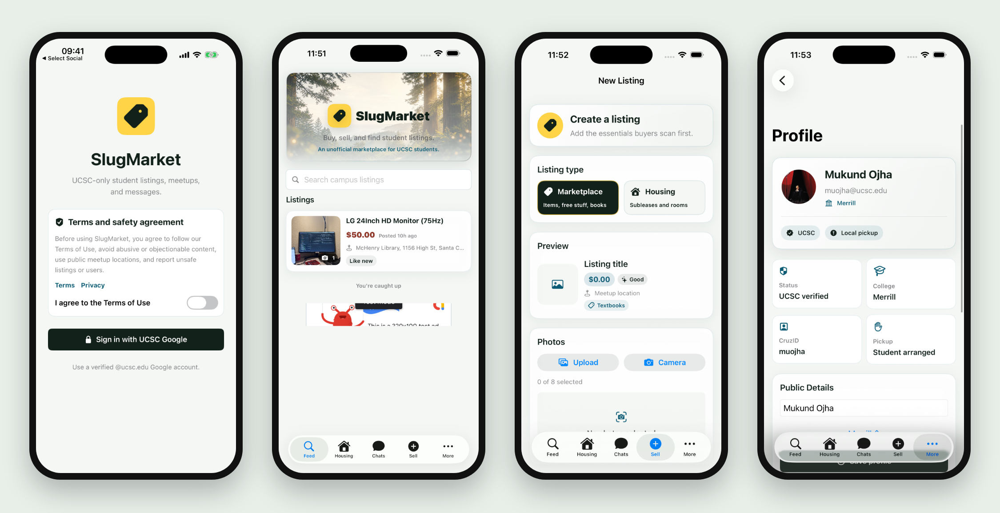

# SlugMarket website

The public website for [SlugMarket](https://apps.apple.com/us/app/slugmarket/id6767780635), a UCSC only marketplace for listings, housing and chat, live on the App Store. This repo holds the landing page and the policy pages the App Store listing links to. The app code is not in this repo.

**[Open the site](https://mukund604.github.io/slugmarket-site/)** · **[Get the app](https://apps.apple.com/us/app/slugmarket/id6767780635)**

## Pages

| Page | Purpose |
| :--- | :--- |
| [`index.html`](index.html) | Landing page |
| [`privacy.html`](privacy.html) | Privacy policy |
| [`terms.html`](terms.html) | Terms of use |
| [`support.html`](support.html) | Support |

Plain HTML and CSS, hosted on GitHub Pages.
